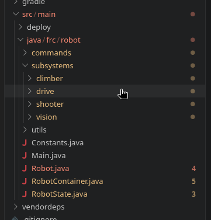

# Code Structure

Code, in our standard convention, is structured like this:  

As clearly visible, there are **4** major subdivisions.

### Subsystems

Subsystems are classes controlling the robot. This includes things like a drivetrain or an arm.

### Commands  

These are discrete commands that do things on the robot, like driving or raising an arm.

### Utils  

These are classes that don't really fit anywhere else, like `LimelightHelpers.java`

### Main files

There are **5** of these
- `Main.java` - this is the main code file, that runs everything else. You will never ever ever need to touch this.
- `Robot.java` - this instantiates `RobotContainer.java` (see below), and runs `periodic` functions.
- `RobotContainer.java` - this instantiates subsystems and button bindings, along with some auto related things.
- `Constants.java` - this contains all the unchanging numbers and values that all the other code uses. This could be things like Spark ID's or a max velocity.
- `RobotState.java` - this holds the state of the robot, position, subsystem states, and all the other robot details that all the files need to access.