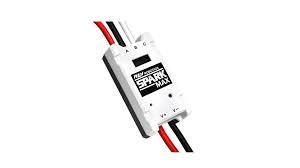

# Controlling a Spark Max
*See https://docs.revrobotics.com/revlib*  
We use SparkMax motor controllers  



## Configuring

They are made by REV, and interface very well with Rev's other hardware, ie, the NEO. They must be configured for each individual case. There are two ways to do this.  
**ONE** is via the *REV Hardware Client*. (See [Navigating The Client](https://docs.revrobotics.com/rev-hardware-client-2/rhc2/navigation))  
This is Rev's application for controlling, managing, and configuring Rev hardware. See [[basics]]

To use, just plug a USB-A to USB-C cable into the laptop and Spark Max.
> **Tip:** If the spark shows up as "Outdated Rev Device", this means that it is running pre-2026 firmware. To fix, unplug it and hold down the button on top while plugging it in again. It should show up as a Recovery Device. Then you can update the firmware to 2026.

**ALTERNATIVELY** you can configure directly from code.  
This done via a `SparkMaxConfig`, as follows. Many other configuration parameters are available

```java
spark = new SparkMax(1, MotorType.kBrushless);
SparkMaxConfig config = new SparkMaxConfig();
config.smartCurrentLimit(40);
spark.configure(config, ResetMode.kResetSafeParameters, PersistMode.kPersistParameters);
```

#### TODO - image here

## Controlling

Spark's have a few different modes for running them. The simplest, and most common, is **Duty Cycle*.

### Duty Cycle
Standard duty cycle takes a setpoint from -1 to 1. This has no feedback control, but integrates nicely with most code because other things in WPILIB, ie, joysticks, return values from -1 to 1.
This is as simple as:
```java
spark.set(.5);
```

### Voltage Mode
Voltage mode takes a voltage from [-12,12]. We don't really use this a ton, except for drive testing in SysID.
```java
spark.setVoltage(10);
```

### Position Control
This is closed-loop position control. It is pretty standard PID.

### Velocity Control
This is closed-loop velocity control. It is *also* pretty standard PID.