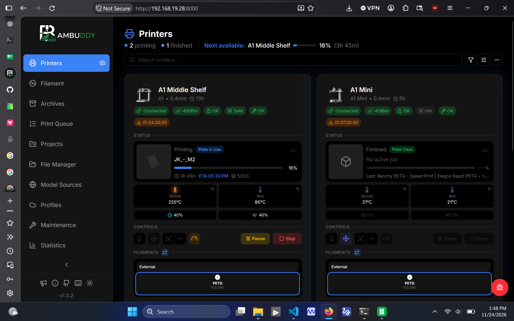

# Bambuddy

[Bambuddy](https://wiki.bambuddy.cool/) is a printer control server.
It organizes files, manages queuing, slices files, provides remote access, and gives a clean web interface.
It can be accessed, as of the time of writing, at [192.168.19.28:8000](http://192.168.19.28:8000)

