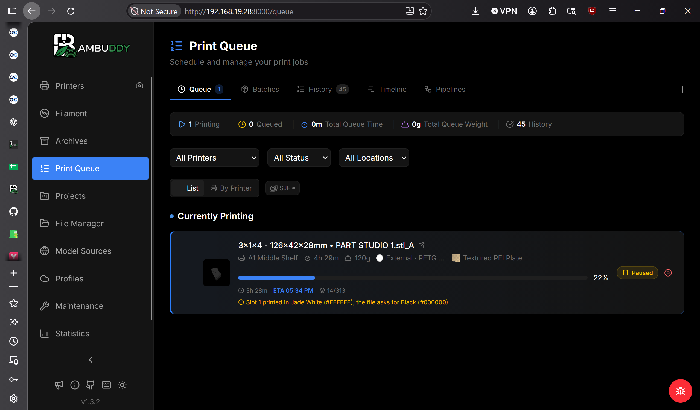
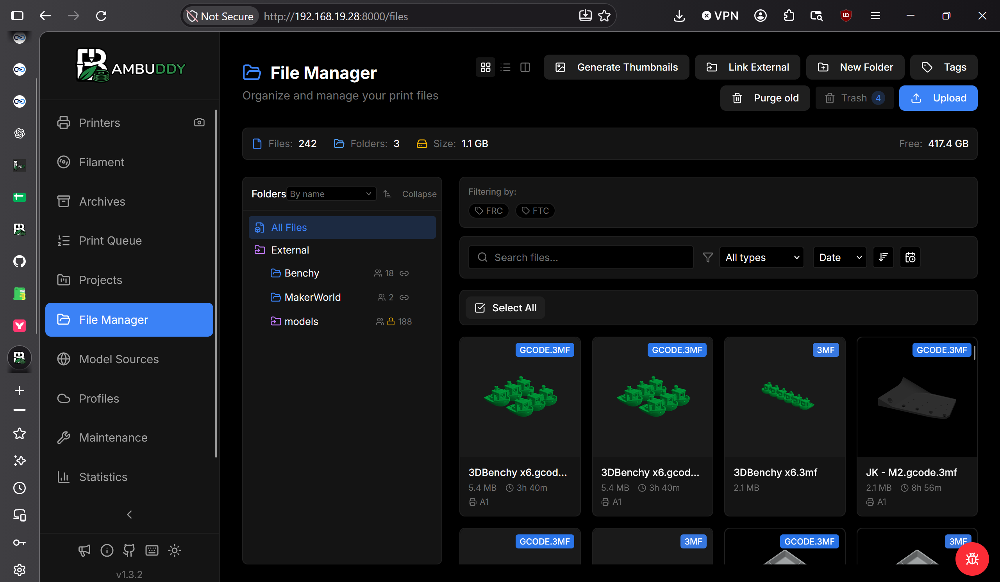
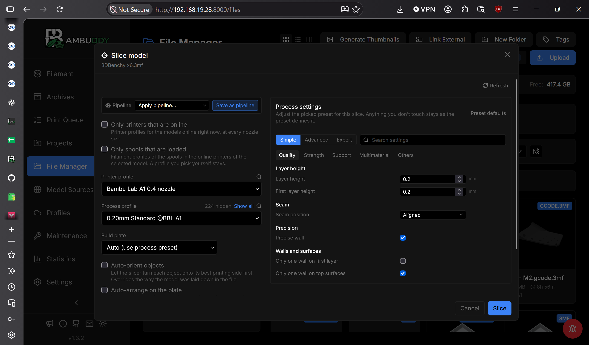

# Features

It has 3 features that the average user needs to be aware of: Queue, File Manager, Slicing.

### Queue

The Queue is the ordered list of things that are going to be printed. 
You add GCODE to the queue, either from the **File Manager** or the Archive (past prints)

### File Manager

The File Manager is the folders and the 3D print files (GCODE, 3MF, STL) on the Bambuddy server.
You can tag files, create folders, sort, and manage.

### Slicing
Bambuddy can slice in the web interface. In general, you should be using pipelines, 
which are set processes for printers, filaments, and others. You can also just select a .3mf and run
it with a pipeline, which slices and queues it.

