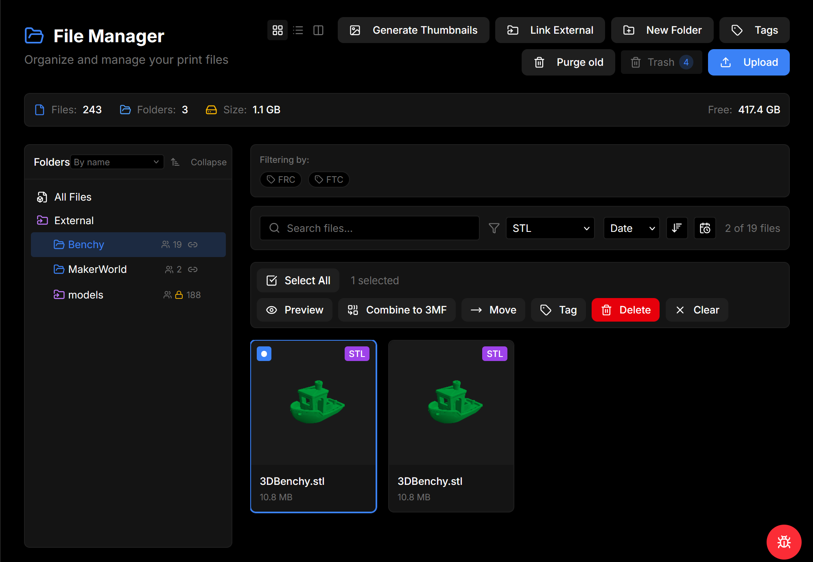
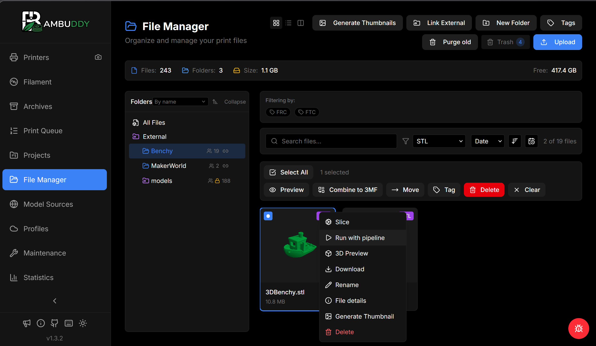
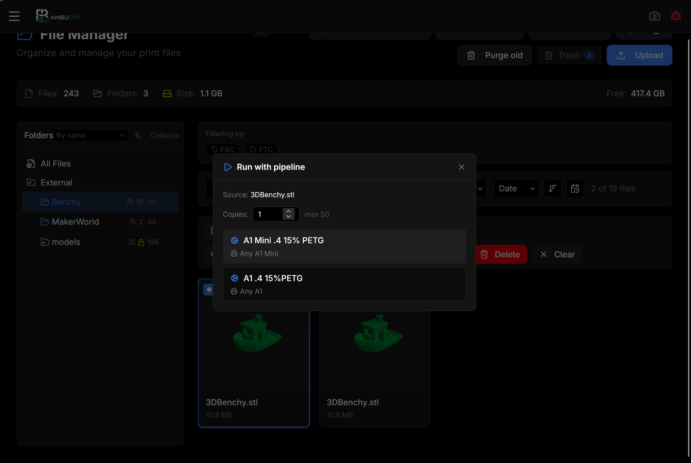

# Usage Walkthrough

This assumes you have an STL. If you don't, there's a basic Benchy STL in the Benchy folder of the File Manager.

There's only one step. Hit the menu button (three dots) and **Run it with a pipeline**

Select the pipeline that fits - Example: A1 Mini, PETG, 15% Infill

This will automatically slice it and queue it.