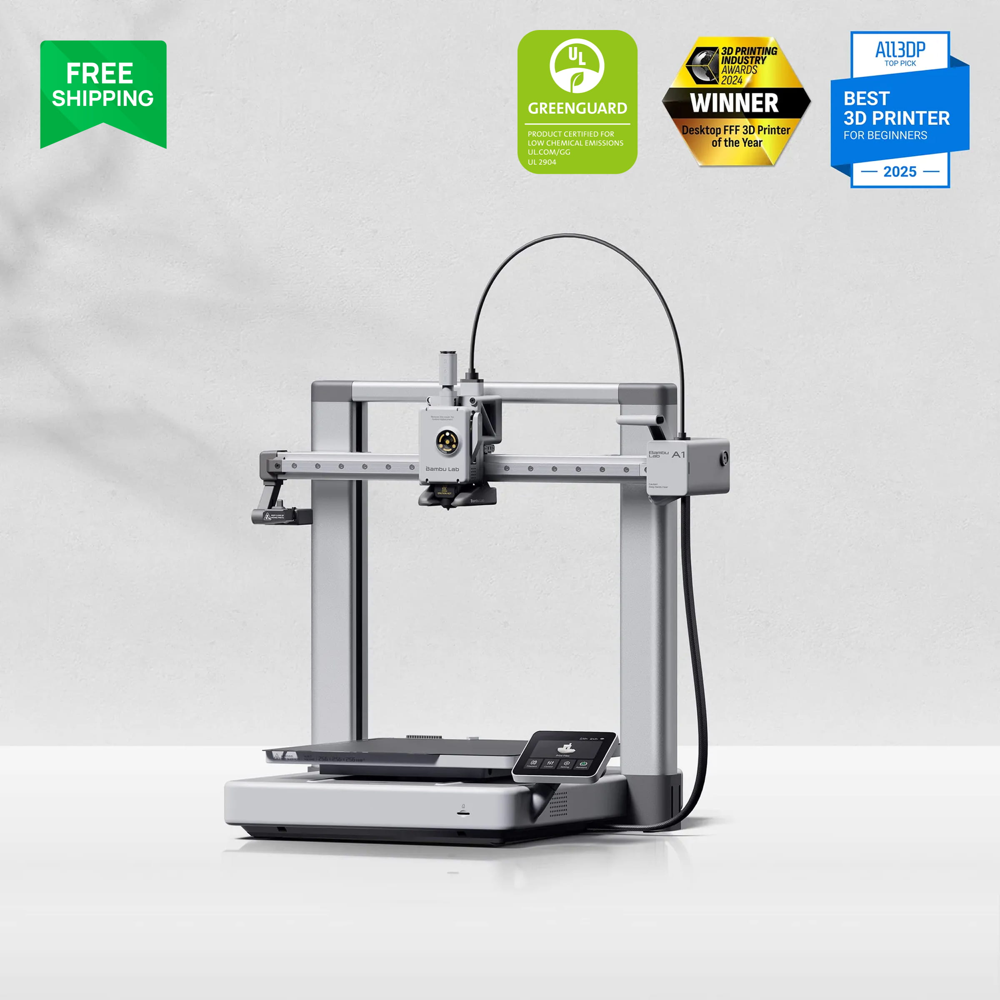
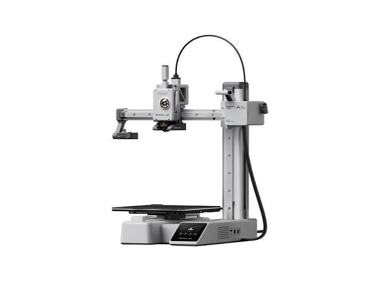
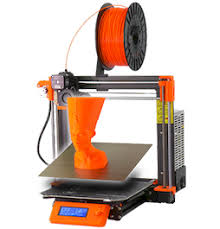
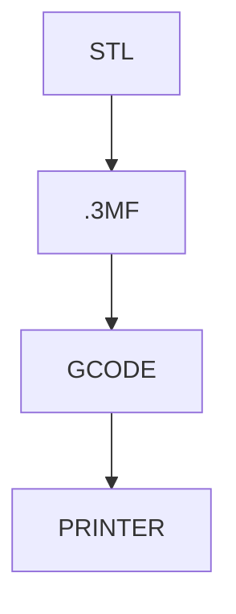

# Introduction to 3D Printing
### What is 3D Printing?
3D Printing is the process of creating 3-Dimensional objects using a 3D Printer. There are two common kinds of 3D printer - only one is relevent to us. We use FDM Printers, specifically (at the time of writing) 2 Bambu A1's, 1 A1 Mini, and 2 Prusa MK3S's.
{/*

*Bambu Lab A1*

*Bambu Lab A1 Mini*

*Prusa MK3 Original**/}

The general workflow is simple - for more detail, see [Workflow](./workflow):

Let's walk through it:

#### What's an STL
An STL is a geometry file, or a 3D Model. In our case you will get them either from Onshape or from the internet somewhere.

#### What's a .3MF
A .3MF is a 3D printer project. It contains geometry (ie, an STL) and print settings like printer model, filament, infill, etc

#### What's GCODE
GCODE is a format for commands sent to a printer. It's not very human readable, but it is just text under the hood. 
It commands the printer to physically move motors and heat the nozzle, among many other things.

#### How do you make these things?
An STL is made in a CAD program, in our case Onshape. It is then imported and sliced. 