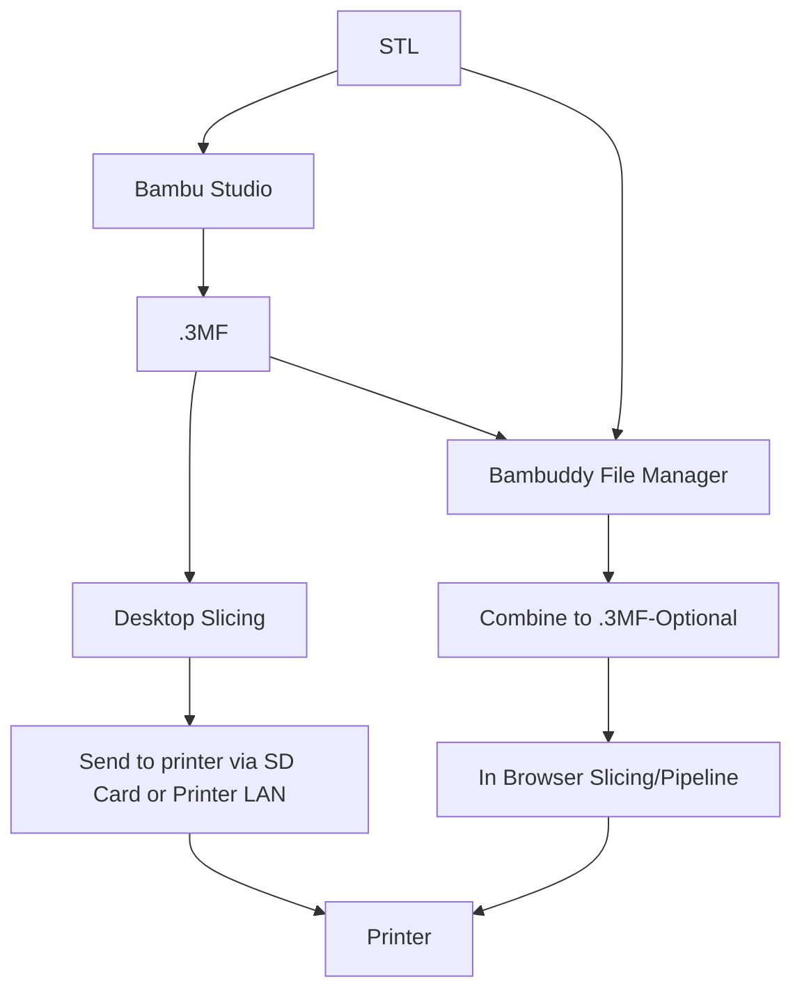

# Our Workflow in More Detail

There are, as seen above, two obvious workflows. 
1) The first involves desktop slicing and then exporting the GCODE to the printer on a microSD card or over LAN.
**I strongly recommended against this workflow** (you cannot possibly know how strongly), 
because it leads to cluttered files, mistakes (possibly expensive mistakes), and mess.
2) This workflow (Through Bambuddy) automatically and safely handles slicing, organizes your files, saves them for future use,
is accessible on any of the robotics class laptops, and handles queuing. It is superior.