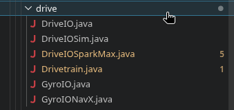

# IO Layers

We used to put all the subsystem code inside on file. This inevitably led to immense, cluttered files, which took time to edit on any scale.  

In the 2025-2026 Rebuilt season, I switched to IO Layers. They do the actual directing of the mechanical/electrical subsytem, the subsystem file only sends commands to them. The IO layers in return send back values in an `IOInputs` class, such as velocities or positions.  

An example can be seen here:
  

The `Drivetrain.java` class sends values to any one of the classes extending `DriveIO`, ie, `DriveIOSparkMax` and `DriveIOSim`. `DriveIOSparkMax` sends commands to the SparkMax's on the robot, and `DriveIOSim` sends commands to a simulated robot.  

The fact that both classes extend `DriveIO` means that they can be used essentially interchangably - we can place a constant in `Constants.java` that does the following:  
``` jsx
public static final Mode currentMode = RobotBase.isReal() ? Mode.REAL : Mode.SIM;

public static enum Mode {
    /** Running on a real robot. */
    REAL,

    /** Running a physics simulator. */
    SIM,

    /** Replaying from a log file. */
    REPLAY
  }


```  

This switches between REAL and SIM depending on whether the robot is running a simulation. Then a piece of logic in `RobotContainer.java` does this,
```jsx
switch (Constants.currentMode) {
    case REAL:
        drivetrain = new Drivetrain(new DriveIOSparkMax(), new GyroIONavX());
        break;
    case SIM:
        drivetrain = new Drivetrain(new DriveIOSim(), new GyroIO(){});
        break;
    default:
        drivetrain = new Drivetrain(new DriveIO() {}, new GyroIONavX() {});
        break;
    }
```  
feeding the `Drivetrain` class a Real or Simulated `DriveIO` depending on the mode.
